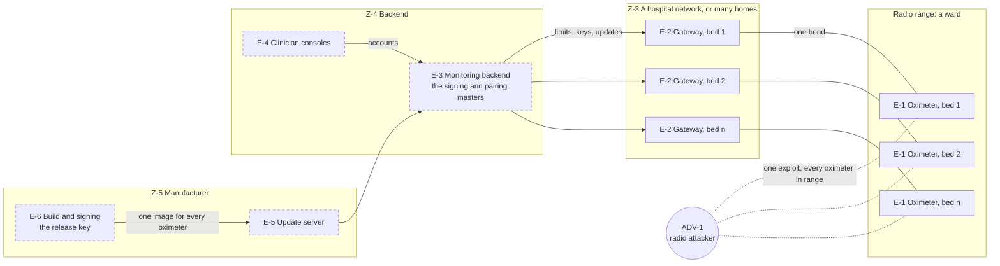

# Multi-patient harm view

How the oximeter and the system around it defend against, and respond to, attacks that could harm many patients at once, the view FDA's premarket guidance asks for (section V.B.2(b)). One attack reaches many patients only where their devices share something: a release, a key, a server, a network, a radio's range, or the same firmware. This view takes each of those in turn: what an attacker gains there, how far it reaches, what's built against it, and what's still only design. The [global system view](system.md#global-system-view) shows every element, and the [updatability view](updatability.md) the update path hop by hop.

> Portfolio exercise, not a medical device.

## Where patients share something

Dashed elements aren't built yet. The gateway is the hub, standing in for the Raspberry Pi.

| What patients share | One attack could | Reach | Threats | Built against it | Design only |
|---|---|---|---|---|---|
| [One release](#one-release-for-every-oximeter) | run the attacker's firmware on every oximeter | every device | T-33, T-34, T-35 | C-05, C-08, C-09, C-20, C-21 | the offline signing service |
| [Keys from the backend's masters](#keys-from-the-backends-masters) | pass as any oximeter's gateway or backend | every device | T-15, T-28 | C-01, C-03, C-04, C-06 | the masters in a hardware security module |
| [The backend](#the-backend-and-its-connections) | change limits, hide alarms or alter records for every patient it serves | a ward or a clinic's patients | T-25 to T-28, T-31 | C-03, C-16, the oximeter's own alarms | all of the backend's controls |
| [Gateways on one network](#gateways-on-one-network) | alter or drop what every compromised gateway relays | a ward | T-22, T-23 | C-02, C-03, C-05, C-14, C-15 | the gateway itself; readings signed end to end |
| [The same firmware within radio range](#the-same-firmware-within-radio-range) | crash or take over every oximeter in range; jam them | a ward, or the oximeters a compromised gateway's radio reaches | T-10, T-16, T-17, T-36 | C-04, C-08, C-10, C-18, C-19, C-20, C-22 | fuzzing the Bluetooth stack before pairing |
| [Monitoring stopping together](#monitoring-stopping-together) | leave every patient unmonitored at once, beyond what staff can cover | a ward | T-10, T-23, T-31 | the oximeter's own alarms, C-16, C-20 | technical alarms at the gateway and the backend; updates a few beds at a time |

## One release for every oximeter

Every oximeter runs the same image, so a malicious one signed as the manufacturer's would run everywhere it was installed (T-33, T-35), and an older, vulnerable one installed again would reopen its flaw on all of them (T-34).

**Built.** MCUboot runs only an image signed with the release key, checked at every boot (C-08), and refuses an update with anything outside its signature (C-09). An update runs first as a trial, and only its own self-test keeps it: no gateway, and so no backend behind one, can keep it for good (C-05, C-20). An update that hangs or fails its self-test is reverted at the next reset. A release whose security counter is below the running image's is erased (C-21). The release key is on no device, and the key check finds it in neither image ([tools/find_keys.py](../../tools/find_keys.py)). Tests: "Never Starts An Image The Release Key Didn't Sign", "Erases An Update With Anything The Release Key Didn't Sign", "Keeps An Update On Trial Whatever The Gateway Says", "Reverts An Update That Fails Its Self-Test", "Refuses An Older Release".

**Design only.** The release key in an offline signing service, with two people approving each release ([updatability view](updatability.md#who-can-start-an-update)); each ward's or clinic's staff choosing which devices get an update, and when.

**What's left.** MCUboot trusts one key and can't be updated, so a stolen release key can be replaced only with every oximeter in hand (T-35, uncontrolled in the [risk assessment](risk-assessment.md#risk-thats-left)). A genuine release with a flaw its self-test doesn't catch reaches every device it's sent to; staff choosing devices and times is what keeps that to a few at first.

## Keys from the backend's masters

No key in the firmware opens more than one device: each oximeter's keys are written into its UICR at the factory, and every device runs the same image with no secret in it (C-06). The backend derives each oximeter's keys from its device ID with HKDF-SHA256, from two masters: the signing master gives the limits key and the log key, and the pairing master the pairing key ([tools/provision.py](../../tools/provision.py)). So a key read out of one oximeter through its debug port (T-15) opens that oximeter only. Tests: `test_gives_each_device_its_own_key`, `test_derives_a_different_key_for_the_log`, and the key check.

The masters open every device, so they're the backend's to protect (T-28). Even so, one leaked master isn't enough from the radio: limits can be written only over a link at security level 4 (C-04), which needs pairing, and so the pairing master (C-01); and a limits change must be signed under the signing master's key (C-03). With the pairing master alone, an attacker in radio range could pair with an oximeter, take its gateway's place (C-02) and read its readings, but not change its limits.

**Design only.** The masters held in a hardware security module, so a compromised backend can ask for keys and signatures but can't take the masters ([risk assessment](risk-assessment.md#risk-thats-left), T-28). The gateway never holds a master: it sends an oximeter's sealed pairing data to the backend to open. Today the hub, standing in for both, holds them.

**What's left.** Nothing in the field replaces a device's keys, so a leaked master means provisioning every oximeter again, in hand.

## The backend and its connections

The backend serves every patient on a ward or in a clinic: a compromised backend, a fake one, a stolen clinician login or tampered traffic between gateways and backend could change limits, hide alarms or alter records for all of them (T-25 to T-28), and a backend that's down stops every remote alarm (T-31).

**Built, on the oximeter.** Each limits change is signed for one oximeter and one challenge, and each challenge works once (C-03), so a command can't be replayed or sent to other devices: a compromised gateway or network can't spread one change to a ward. Tests: `test_never_accepts_the_same_command_twice`, `test_rejects_a_tag_made_for_another_challenge`, `test_commands_signed_with_another_key_are_refused`, "Refuses Limits From A Hub Without Its Key". The oximeter decides its own alarms, on limits it keeps through a reset (C-16), and lights its LED whatever happens upstream ([README](../../README.md#alarms)). The oximeter refuses limits outside its ranges whoever signs them, but a 50% SpO2 limit is a valid setting, and it silences most hypoxia alarms: against a compromised backend, these are no defense.

**Design only.** Mutual authentication and encryption between gateway and backend, such as TLS with a certificate on each side (T-25, T-26); multi-factor sign-in, with each clinician reaching only their own patients (T-27); the masters in a hardware security module, least privilege and monitoring (T-28); a backend run with redundancy (T-31).

## Gateways on one network

On a ward there's a gateway at every bed, all on the hospital network, all running the same software: a flaw in it lets a network attacker take over many at once (T-22), and a network outage takes them down together (T-23).

**Built, on the oximeter.** A compromised gateway can't forge limits (C-03), keep an update (C-05), or edit or hold back the security log unnoticed (C-14, C-15). Each oximeter keeps one bond (C-02), so beyond what any device in range can do, a gateway reaches only the oximeter it paired with; pairing with another needs that oximeter's sealed data opened by the backend (C-01). Tests: "Refuses Limits From A Hub Without Its Key", "Keeps An Update On Trial Whatever The Gateway Says", "Verifies Every Record Of The Log", "Shows Whether The Hub Read The Whole Log", "Lets A New Gateway's Pairing Replace The Old One".

**Design only.** The Raspberry Pi gateway, its signed A/B updates ([updatability view](updatability.md#the-gateways-own-updates)) and its hardening; readings and alarms tagged by the oximeter, so the backend can tell an altered one (T-22); a technical alarm at the backend when a gateway goes quiet (T-23).

## The same firmware within radio range

Every oximeter runs the same Bluetooth stack, and anything in range reaches it before pairing. A bug there (T-16), in Zephyr or another component (T-36), would let one attacker crash or take over every oximeter within radio range, tens of metres: on a ward, the ward. An attack that crashes the oximeter repeats at will (T-17), and a jammer cuts every oximeter in range off from its gateway without touching the protocol (T-10). The radio doesn't reach from the internet, but each gateway has a radio next to its oximeter, so a network attacker who takes over the gateways (above) could use them to reach every oximeter on a ward.

**Built.** An unpaired device can read only the device ID and the sealed pairing data (C-04), and reaches only the Bluetooth features the oximeter uses (C-26); the parsers of what other devices send are fuzzed (C-10); a change an exploit makes to the firmware doesn't survive a restart, since a modified image won't boot (C-08); the watchdog restarts a hung oximeter within 2 s (C-18); the gateway notices a silent oximeter within half a second (C-19); and every week CI checks every component for known vulnerabilities (C-22), whose fixes ship as signed updates (C-20). Tests: "Refuses A Phone That Isn't Paired", the fuzz targets, "Recovers From A Hang Through The Watchdog", "Notices A Silent Oximeter Within Two Seconds".

**To do.** Fuzz the link layer, which Zephyr's controller handles before anything reaches the host (T-16, T-36). No control rules out a flaw in third-party code; the [risk assessment](risk-assessment.md#risk-thats-left) gives the reasons this can't be designed out.

## Monitoring stopping together

FDA's guidance warns of monitors on one network all restarting at once, leaving more patients unmonitored than staff can watch. Here that could come from a backend that's down (T-31), gateways down together (T-23), a jammed ward (T-10), or updates installed on many beds at once.

**Built.** Each oximeter keeps measuring and alarming at the bedside, on the clinician's limits, whatever happens to its gateway and the backend ([README](../../README.md#alarms)), and keeps those limits through a reset (C-16). An update pauses an oximeter's monitoring for under 30 s, from the gateway's reset command to the next reading (C-20, "Resumes Monitoring Soon After An Update"), and monitoring continues while the update uploads ("Loses No Sample During An Update").

**Design only.** A technical alarm at the gateway and the backend within 2 s of readings stopping, so a loss is never silent (T-10, T-23, T-31); updates installed at a time staff approve, announced as "paused for update" ([updatability view](updatability.md#interrupted-and-failed-updates)), and on a ward a few beds at a time, so the pauses don't overlap.

## Seeing an attack on many, and recovering

**Seeing it.** Each oximeter's security log records its start-ups with the version running, its connections, pairings and refused ones, and limit changes and refused ones (C-13), each record tagged so the backend can tell it's genuine (C-14), with proof the backend has read it all (C-15). Read across devices, the logs show an attack on many: refused pairings or refused limit changes on many beds at once. The backend's analysis of them is design.

**Recovering.** A fix reaches every oximeter as a signed update (C-20), and the version in each start-up record shows which devices have it. Once a release fixes a vulnerability, its security counter keeps older ones out (C-21). The reset for a new patient (C-12) makes an oximeter forget a gateway that can't be trusted any more. Two things can't be recovered in the field: a stolen release key and a leaked master both mean every oximeter in hand.

## In the risk assessment

The [risk assessment](risk-assessment.md) rates each threat by the worst harm it could cause one patient, and every threat here that can harm a patient is already at the top of that scale, Catastrophic. How many patients a threat reaches is in its impact, and in the CVSS scope where the central station's alarms depend on what's attacked, rather than in a severity that can't go higher. After controls, all of them are still uncontrolled except T-15 and T-34, mostly because the backend and the gateway aren't built yet.
