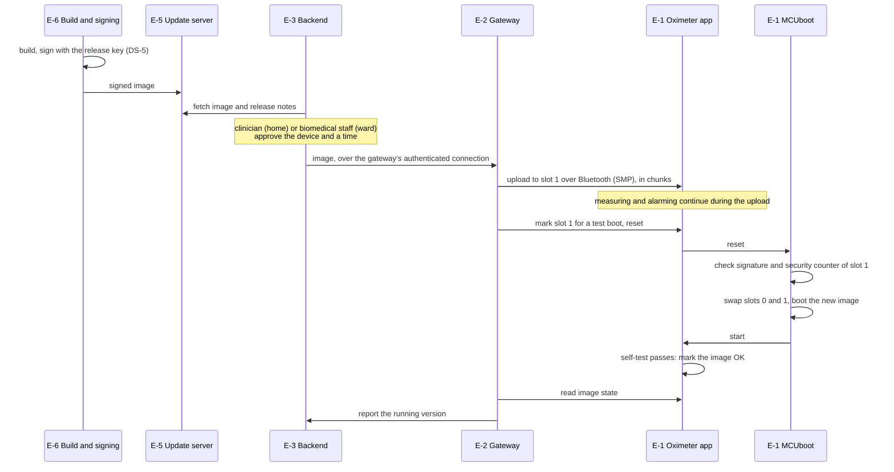

# Updatability and patchability view

How a software fix reaches the oximeter and the bedside gateway, end to end: from the manufacturer's build, through servers and networks the manufacturer doesn't control, to the device. FDA's premarket guidance asks for this view in section V.B.2, with the level of detail in its Appendix 2, and recommends that the update path be protected end to end because it crosses technology the manufacturer doesn't control.

> Portfolio exercise, not a medical device.

## Today

There is no update path yet (T-32). The oximeter's firmware can only be changed through its SWD debug port (I-4), which is unlocked. MCUboot runs only an image signed with the release key, but through the unlocked port anyone can replace MCUboot too (T-14). The hub, the gateway's stand-in, has no MCUboot and no update path. Fixing a vulnerability would mean physically reaching every device.

Everything below is the design Phase 4 builds. Each part says whether it exists yet.

## Design in one paragraph

The manufacturer signs every release. The signature is checked only on the device that runs it: by MCUboot on the oximeter, and by the update client on the gateway. The servers, networks and the gateway in between carry images but can't change them undetected, so the path needs no trust in them for integrity; they matter for availability and for deciding who gets which update when. A device that receives a broken or unbootable image goes back to the image it had.

## The oximeter update path

| Hop | From, to | Carries | Protocol | Protection | Status |
|---|---|---|---|---|---|
| 1 | E-6 to E-5 | signed image | HTTPS, TLS 1.3 | the image's signature; the release pipeline authenticates to the server | planned |
| 2 | E-5 to E-3 | signed image, version, security counter, target hardware | HTTPS, TLS 1.3 | server certificate; at home over the internet, on a ward the hospital's server fetches it | planned |
| 3 | E-3 to E-2 | signed image | HTTPS, TLS 1.3, both sides authenticated by certificate (I-6) | the gateway only accepts updates from its own backend | planned |
| 4 | E-2 to E-1 | signed image, upload and test commands | MCUmgr SMP over Bluetooth LE: service `8d53dc1d-1db7-4cd3-868b-8a527460aa84`, characteristic `da2e7828-fbce-4e01-ae9e-261174997c48` (I-8) | the SMP characteristic requires an encrypted, authenticated link. With pairing allowed only while a device is being set up (Phase 4), that means the bonded gateway | planned |
| 5 | slot 1 to slot 0 | the image | MCUboot, on the device | signature and security counter checked before the image is used | done |

Hop 4 relies on the Bluetooth pairing and bonding that Phase 4 adds for the readings and the alarm limits. Zephyr's SMP transport already defaults to requiring an authenticated link once pairing is enabled (`CONFIG_MCUMGR_TRANSPORT_BT_PERM_RW_AUTHEN`). Without it, anyone in radio range could upload; the signature check would still stop them installing anything the manufacturer didn't sign.

## Verification on the oximeter

| What | Design | Why | Threat | Status |
|---|---|---|---|---|
| Signature | ECDSA P-256 with SHA-256 over the image and its header, checked by MCUboot; the public key is built into MCUboot | a NIST-approved algorithm (FIPS 186-5) with 128-bit security, supported by MCUboot at the commit Zephyr v4.4.2 pins | T-33 | done |
| Check on every boot | the running image's signature is checked at each boot, not only after an update (`BOOT_VALIDATE_SLOT0`, MCUboot's default) | an image altered in flash some other way still won't run | T-14 | done |
| Rollback | each image carries a security counter in its signed metadata. MCUboot refuses an update whose counter is below the running image's. A release that fixes a vulnerability raises the counter, which blocks every image before it (`MCUBOOT_DOWNGRADE_PREVENTION_SECURITY_COUNTER`) | a genuine but older image would reopen a fixed vulnerability | T-34 | done |
| Debug port | locked at startup (`CONFIG_NRF_APPROTECT_LOCK`) | MCUboot's own documentation notes that its rollback check can be bypassed by writing flash through a debug port. Signature, rollback and debug lock only work together | T-14, T-15 | planned, needs hardware |
| Flash layout | the nRF52840 DK's standard partitions: MCUboot 48 KB, two image slots of 472 KB, storage 32 KB | MCUboot takes 30 KB and the image 167 KB today. FDA asks for room for future patches, and each slot has almost three times what's needed now | T-32 | done |

The release key never leaves the build environment (DS-5): an attacker with it can sign anything (T-35). In this project the build makes one per checkout, in `build/release-key.pem`, never committed, so no two checkouts share a key. A product keeps its release key in an offline signing service, which only the release process can use. MCUboot's own development key, sysbuild's default, is never used: its private half is published with MCUboot, and a test checks that an image signed with it doesn't run. The key MCUboot trusts is built into MCUboot, which can't be updated in this design, so replacing a compromised key needs physical access to every device. That limitation goes into the risk assessment.

## Interrupted and failed updates

FDA asks what happens when an update is interrupted, at each phase of the process. MCUboot's swap mode is chosen for this: it keeps the previous image until the new one has proved it works. Of its swap methods, swap using offset is the one MCUboot recommends for new products, and it writes less flash than swap using move.

| What happens | Result | Status |
|---|---|---|
| The Bluetooth link drops during the upload | slot 1 holds a partial image that is never booted. The running image is untouched, and the gateway starts the upload again on the next connection | planned |
| The image fails its signature or rollback check | MCUboot erases it from slot 1 and boots the current image. The app is to report the rejection to the gateway and record it in the security log, with the upload (hop 4) | MCUboot's part done; reporting planned |
| Power is lost during the swap | MCUboot records the swap's progress in the slots' trailers and finishes it after the next reset. MCUboot's own simulator tests this, cutting power at each flash write of a swap in turn, and its CI runs it with swap using offset; Renode tests here would add nothing to that | done, MCUboot's tests |
| The new image boots but doesn't pass its self-test, or hangs | it never marks itself OK. A watchdog (T-17) resets a hung image. At the next reset MCUboot swaps the previous image back | done |
| The new image passes its self-test | it marks itself OK and the swap becomes permanent | done |

The self-test that confirms an image checks that the sensor answers with its part ID, the analysis runs, and the Bluetooth stack is up. The first reading shows all three, since the sensor starts only after Bluetooth. It doesn't wait for the gateway to connect, because a gateway outage shouldn't undo a good update.

**Monitoring during an update.** The upload runs while the oximeter keeps measuring and alarming. Flash writes stall the processor, so they must never stall it for longer than the sensor's 32-sample FIFO holds, 320 ms at 100 samples a second. The swap and reboot do stop monitoring for a few seconds. So an update is installed only at a time the clinician approves, and the gateway reports "paused for update" to the backend. That way the gap is announced, not silent like T-10 and T-23. Phase 6 measures both the stalls and the gap.

## The gateway's own updates

The gateway runs Linux on a Raspberry Pi and updates itself with A/B root partitions:

| What | Design | Status |
|---|---|---|
| Format | a signed update bundle (RAUC, or SWUpdate: both are packaged by Buildroot), signed with a separate gateway release key | planned |
| Install | written to the root partition that isn't running, with the running system untouched | planned |
| Switch | the Pi's firmware boots the new partition once ("tryboot"); the system marks it good only after its health checks pass, or falls back on the next boot | planned |
| Rollback | a version check at install refuses bundles older than the installed one | planned |
| Settings and pairings | kept on a separate data partition both systems can read, so an update doesn't unpair the oximeter | planned |

## Who can start an update

| Step | Who | Control |
|---|---|---|
| Sign a release | the manufacturer's release process only | the release key's access controls (Phase 4); two people approve a release |
| Choose which devices get it, and when | home: the clinic; ward: the hospital's biomedical staff | backend accounts and roles (T-27, T-28) |
| Upload to the oximeter | the gateway it's bonded to | the authenticated SMP link (hop 4) |
| Install it | MCUboot | the signature and the security counter |

A compromised server or gateway can withhold or delay updates, a denial of service that the backend can detect from the versions devices report. It can't install firmware the manufacturer didn't sign (T-22, T-33).

## Third-party software

| Component | Where | How a fix ships |
|---|---|---|
| Zephyr, pinned to v4.4.2 in `app/west.yml` | oximeter | move the pin to the patch release with the fix, rebuild, ship through the path above |
| Zephyr's Bluetooth controller (`CONFIG_BT_LL_SW_SPLIT`) | oximeter | built into the same image, so controller fixes ship with the firmware: no separate radio firmware to update |
| MCUboot | oximeter | MCUboot can't replace itself in this design. A bootloader fix needs physical access, so MCUboot is kept minimal and its configuration fixed. Its vulnerabilities are assessed like any other component's (Phase 5) |
| TinyCrypt, MCUboot's own copy | oximeter, inside MCUboot | built into MCUboot, so a fix needs physical access, as MCUboot's does. It checks signatures instead of PSA Crypto, which the app uses: in MCUboot, PSA Crypto needs a random source, and with no threads for the nRF52840's random number generator driver it falls back to Zephyr's test-only generator. The original TinyCrypt project is no longer maintained, so MCUboot's copy is watched like MCUboot itself. Checking a signature handles no secret, so timing leaks don't apply to it |
| Linux, Buildroot packages | gateway | Buildroot LTS patch releases, shipped as gateway bundles |

FDA also asks manufacturers to keep everything needed to build and test a patch long after release. Here the build is fully pinned: the west manifest, the Zephyr SDK version and the CI configuration. The whole system also runs in Renode with no hardware, so a fix can be tested end to end on any machine years from now. The SBOM in Phase 5 lists every component, and the postmarket plan in Phase 7 covers monitoring them and how fast fixes ship. Security fixes ship as their own releases, not waiting for feature releases.

## Threats this view addresses

| Threat | Today | After Phase 4 |
|---|---|---|
| T-14 Malicious firmware through the debug port | exploitable | debug port locked; MCUboot checks every boot |
| T-17 A hang stops monitoring | exploitable | a watchdog resets the device, and a new image that hangs is reverted |
| T-32 No field updates | exploitable | the path above |
| T-33 Forged image | not yet built | signature checked on the device |
| T-34 Rollback to a vulnerable image | not yet built | security counter, with the debug port locked |
| T-35 Stolen release key | not yet built | key access controls; the single-key limitation above is assessed as residual risk |
| T-36 Vulnerable third-party component | partly mitigated | everything above the bootloader can be updated; SBOM and monitoring in Phase 5 |
