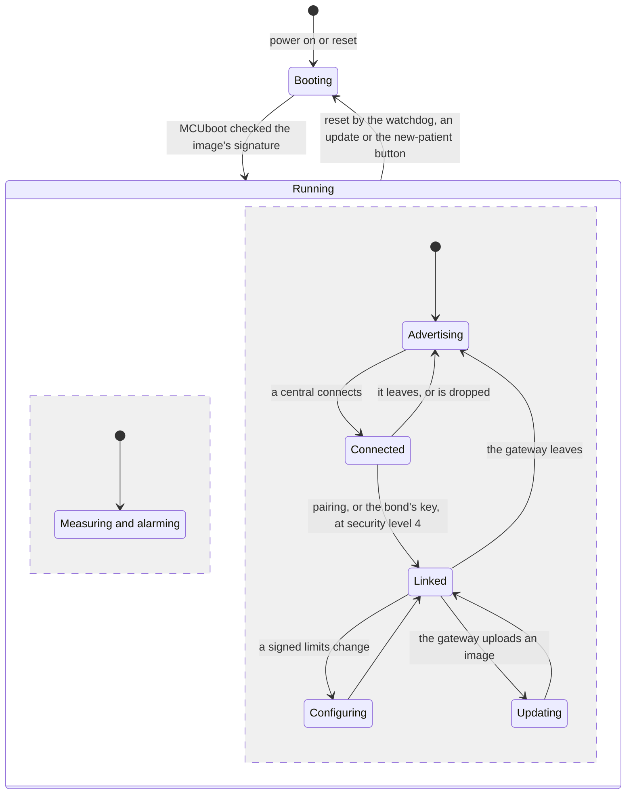
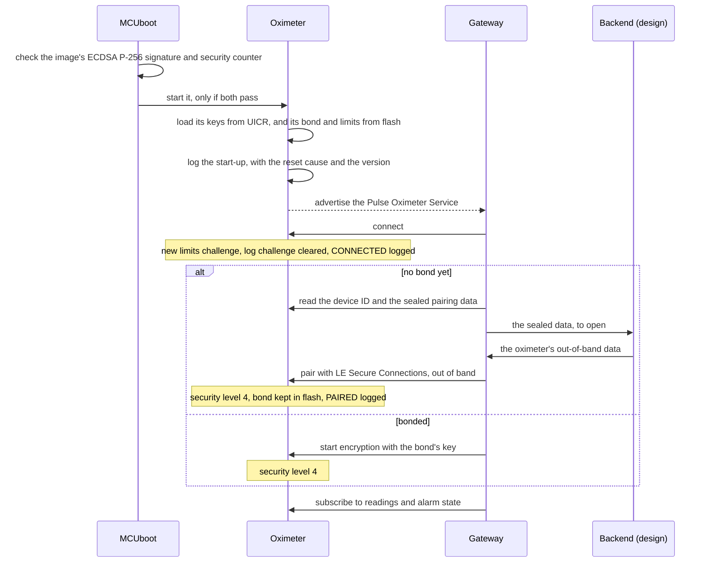
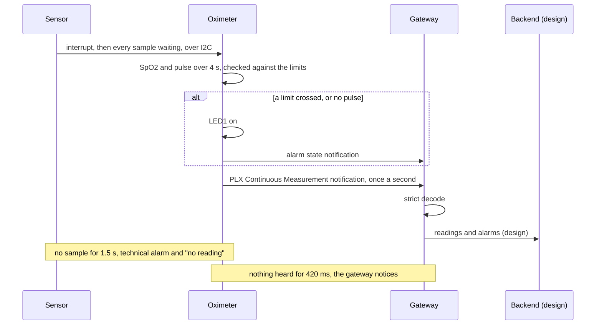
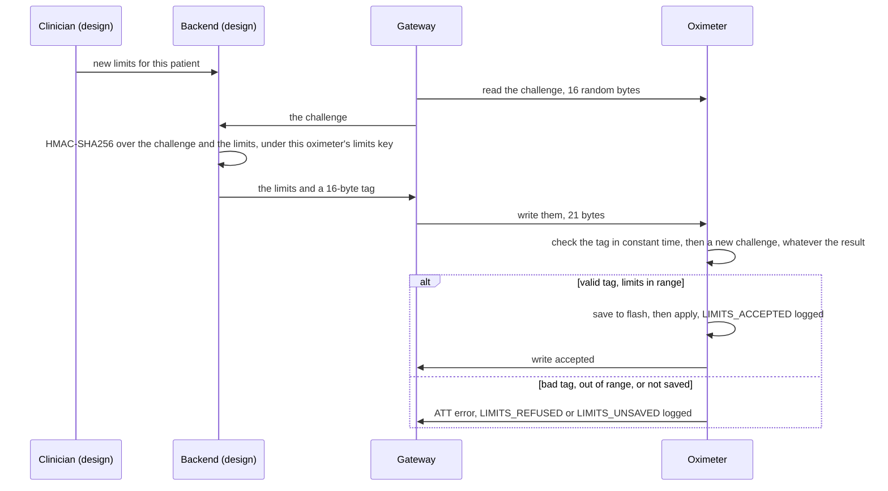
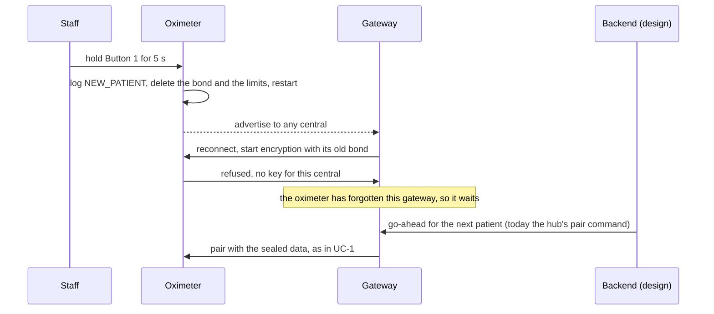

# Security use-case views

Each function of the oximeter through which an attack could affect its safety or effectiveness, followed through the device's states, as FDA's premarket guidance asks (section V.B.2(d)). The use cases are the six in the [system description](system.md#use-cases). Readings and alarms travel the same way under the same protection, so they share one view, as the guidance allows for use cases with the same security assessment; the firmware update has its own view already, in the [updatability view](updatability.md). Each view gives the sequence, what protects each step, what happens when a step goes wrong, and the controls ([controls.md](controls.md)), threats ([threat model](threat-model.md)) and tests behind it.

> Portfolio exercise, not a medical device.

The gateway in these views is the hub, which stands in for both the Raspberry Pi gateway and the backend. Where the design gives a step to the backend, the view says so and says what the hub does today.

## Device states

Measuring and alarming go on in every state once the image has started, whatever happens on the link.

| State | Who can do what |
|---|---|
| Booting | MCUboot runs only an image signed with the release key (C-08, C-09, C-21) |
| Advertising | any central may connect, or only the bonded gateway while a stranger holds the other connection (C-23) |
| Connected | below security level 4, a central can read only the device ID and the sealed pairing data (C-04), and is dropped after 30 s (C-23) |
| Linked | the paired gateway, at level 4: readings, alarm state, limits, the security log, updates |
| Configuring | a limits change applies only with a valid tag over this connection's current challenge (C-03) |
| Updating | the gateway can upload and ask for a test boot; only the update's self-test keeps it (C-05, C-20) |

## UC-1 Power on and connect

States: booting, advertising, connected, linked.

**Booting.** MCUboot checks the image's ECDSA P-256 signature over SHA-256 at every boot, with the release key's public half built in, and refuses an image with anything outside its signature or a security counter below the running one's (C-08, C-09, C-21). If no image passes, nothing runs. The oximeter then loads its three 32-byte keys from UICR (C-06); if they were never provisioned, it logs that, can't seal pairing data, and refuses every limits change.

**Advertising.** The oximeter advertises the Pulse Oximeter Service, with its name in the scan response. Who may connect follows C-23: anyone while nobody is connected; while a central below level 4 holds a connection, only the bonded gateway, through the controller's accept list; nobody while the gateway is linked. The fixed address and the name let anyone in range follow the device (T-13, no control yet).

**Pairing.** Each read of the sealed pairing data makes fresh LE Secure Connections out-of-band data, a random value and its confirmation, sealed with AES-CCM under the oximeter's pairing key and bound to its device ID ([app/src/pairing.c](../../app/src/pairing.c), [common/src/pairing_seal.c](../../common/src/pairing_seal.c)). Only a holder of the pairing master can derive that key: in the design the backend opens the seal for the one gateway it authorizes; today the hub opens it itself. Pairing is LE Secure Connections only (P-256 ECDH, AES-CCM link encryption with a 128-bit key), so Just Works and legacy pairing are refused. The out-of-band data proves the oximeter's public key to the gateway, and pairing proves to the oximeter that the gateway could open the seal, which shuts out a man in the middle (C-01). The bond, with its long-term key, is kept in flash. The oximeter keeps one: a new pairing replaces the old gateway's (C-02).

**Each connection is a session.** On connecting, the oximeter makes a new limits challenge and clears the log challenge (C-03, C-15), so nothing signed on an earlier connection works on this one.

**When it goes wrong.** A failed pairing is logged with Zephyr's reason, and the out-of-band data is forgotten, so the next pairing gets new data. A central that connects and doesn't reach level 4 within 30 s is dropped (C-23). A reconnecting gateway whose bond the oximeter has forgotten is refused, and waits for the backend (UC-6).

**Threats.** T-01, T-02, T-05, T-07, T-08, T-09, T-11, T-13, T-14, T-33, T-34. **Tests.** "Never Starts An Image The Release Key Didn't Sign", "Erases An Update With Anything The Release Key Didn't Sign", "Refuses An Older Release", "Can't Be Paired Without A Device Key", "Keeps Its Pairing Through A Reset", "Lets A New Gateway's Pairing Replace The Old One", "Refuses A Phone That Isn't Paired", "Refuses A Phone That Pairs With Just Works", "Logs The Pairing", "Logs A Refused Pairing", the five T-11 tests under C-23; `test_opens_what_it_sealed`, `test_refuses_what_it_cannot_authenticate`, `test_seals_with_a_fresh_nonce_each_time`.

## UC-2 and UC-3 Measure, send readings, and raise and clear an alarm

States: measuring, sending, alarming. Both use cases cross the same boundary, the air between oximeter and gateway (TB-1), over the same encrypted link.

**Measuring.** The sensor's samples cross only the I2C bus inside the enclosure (I-1), unprotected, so a replaced sensor or injected signals go undetected (T-19, no control yet). The oximeter decides its own alarms on the limits it holds, and lights its LED whatever happens on the link.

**Sending.** Readings and alarm state go only to a gateway subscribed at security level 4: subscribing needs a level-4 write (C-04), over a link encrypted and authenticated by pairing (C-01). The gateway decodes readings strictly, refusing reserved flags, lengths that don't match the flags and values out of range (C-10). Readings and alarms aren't signed end to end, so a compromised gateway can still alter or drop them (T-22). The console logs readings in plain text (T-20, no control yet).

**The security log.** The paired gateway reads the log over the same link, at level 4; each record is tagged under the oximeter's log key (C-14). To show it read everything, it writes a fresh challenge and reads back the newest record's number, tagged with that challenge (C-15).

**When it goes wrong.** If the sensor stops, the oximeter raises the technical alarm within 1.5 s and sends "no reading" once a second (C-17); if the firmware hangs, the watchdog restarts it within 2 s (C-18). If the link drops or is jammed, the oximeter keeps measuring and alarming at the bedside, and the gateway notices within half a second (C-19) and reconnects with its bond; readings sent in the gap are lost, and the alarm that should tell clinicians comes with the gateway and the backend (T-10). If interrupts are held up, by a flash erase for instance, the oximeter reads every sample waiting, and starts a new reading rather than one across samples the sensor lost.

**Threats.** T-07, T-09, T-10, T-16, T-17, T-18, T-19, T-20, T-22. **Tests.** "Hears Readings After Every Reconnection", "Alarms On Limits The Hub Signs", "Raises The Technical Alarm When The Sensor Stops", "Notices A Silent Oximeter Within Two Seconds", "Recovers From A Hang Through The Watchdog", "Reads Every Sample Waiting In The Sensor", "Starts A New Reading After The Sensor Loses Samples", "Refuses A Phone That Isn't Paired", "Verifies Every Record Of The Log", "Shows Whether The Hub Read The Whole Log"; `test_rejects_reserved_flags`, `test_rejects_a_length_that_does_not_match_its_flags`, the fuzz target `fuzz_plx_decode`.

## UC-4 Set alarm limits

States: linked, configuring. The command a nurse or clinician gives at the backend crosses three boundaries (TB-5, TB-4, TB-1), and only the oximeter checks it.

**Authentication.** A command is the five limit bytes and an HMAC-SHA256 tag, cut to 128 bits, over the challenge and the limits ([core/src/limits_auth.c](../../core/src/limits_auth.c)). The key is the oximeter's own limits key, which only it and the backend can derive from the signing master (C-06). The challenge comes from a cryptographically secure source backed by the hardware random number generator (C-07). It's replaced after every attempt, accepted or not, and on every connection, so each tag works once, on one oximeter (C-03). PSA Crypto compares tags in constant time. Today the hub signs, standing in for the backend; in the design the gateway only relays, so a compromised gateway can't forge a change (T-21, T-22).

**Range and storage.** The oximeter refuses limits a monitor wouldn't offer (SpO2 limit 50 to 99%, pulse 30 to 240 bpm, the low below the high), whoever signed them. A change is saved to flash before it applies, so a change a reset would undo is refused rather than applied until the next reset (C-16). Each accepted or refused change is logged, with the reason for a refusal (C-13).

**When it goes wrong.** A refused change leaves the last accepted limits in force. If the link drops after the write, the gateway can read the limits back at level 4 to see whether it took; a retry needs a new tag over the new challenge. Who at the backend made the change isn't recorded on the oximeter; that's the backend's (T-04, T-30).

**Threats.** T-01, T-02, T-03, T-04, T-06, T-21, T-22, T-25, T-27, T-28. **Tests.** "Alarms On Limits The Hub Signs", "Refuses Limits From A Hub Without Its Key", "Keeps The Clinician's Limits Through A Reset", "Logs The Security Events The Hub Reads", "Logs A Refused Change From A Hub Without Its Key"; the ten tests of [tests/test_limits_auth.c](../../tests/test_limits_auth.c), among them `test_never_accepts_the_same_command_twice` and `test_rejects_a_tag_made_for_another_challenge`; `test_signs_commands_the_oximeter_accepts`, `test_commands_signed_with_another_key_are_refused`; the fuzz target `fuzz_limits_command`.

## UC-5 Update firmware

States: linked, updating, booting. The [updatability view](updatability.md) follows an update from the manufacturer to the oximeter, hop by hop, and what happens when each phase is interrupted, so it isn't repeated here. On the oximeter:

| Step | Protected by | If it goes wrong |
|---|---|---|
| The gateway uploads the image over MCUmgr's SMP, in pieces | a link at security level 4 (C-04) | a partial image is never marked or booted |
| It marks the image for a test boot and resets the oximeter | the same link; the oximeter logs the version marked (C-13) | |
| MCUboot checks the new image and swaps it in | its signature, nothing outside it, its security counter (C-08, C-09, C-21) | the image is erased and the old one boots; the log shows the old version starting |
| The update runs its self-test: the sensor answered, Bluetooth is up, the analysis gave a reading | only the self-test can keep the image; the gateway can't (C-05) | at the next reset, by the watchdog if it hangs, the old image comes back (C-20) |

Monitoring goes on while the image uploads, and stops for under 30 s from the reset to the next reading (C-20).

**Threats.** T-17, T-22, T-32, T-33, T-34, T-35, T-36. **Tests.** Those of C-20 and C-21.

## UC-6 Decommission and reuse a device

States: between patients, booting, then UC-1.

**Forgetting.** Holding Button 1 for 5 s deletes the bond and the stored limits, and the oximeter restarts with the default limits (C-12). A shorter press, as from a patient lying on it, does nothing. Only physical access can do this: nothing over the air resets the oximeter for a new patient. The old gateway's key no longer works, and a new pairing needs sealed data the backend opens only for the next patient's gateway (C-01, C-02).

**What stays.** The device keys stay in UICR: they belong to the device, not the patient. The security log stays, and records the reset, so a reset can't erase the evidence of what came before it (C-13). It holds the old gateway's address and the limit changes, but no readings, which the oximeter never stores.

**When it goes wrong.** If staff forget the reset, the old gateway still connects (T-37), a use error passed to the safety risk assessment ([risk assessment](risk-assessment.md#to-the-safety-risk-assessment)). How to dispose of a device for good, including its keys and log, belongs in the labeling, still to be written (Phase 7).

**Threats.** T-12, T-37. **Tests.** "Goes Back To The Default Limits For A New Patient", "Ignores A Short Press", "Pairs Again Once The Backend Allows It", "Logs The Reset For A New Patient"; `test_forgets_the_limits_when_cleared`.
